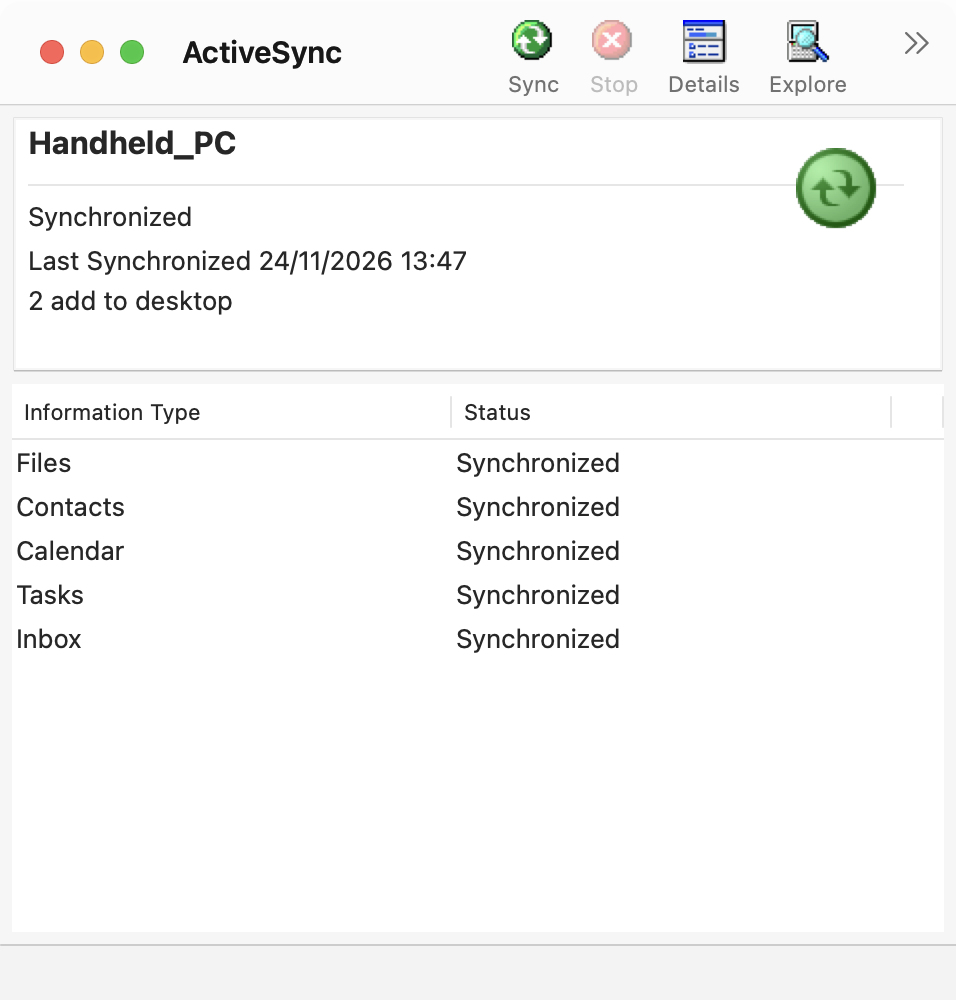
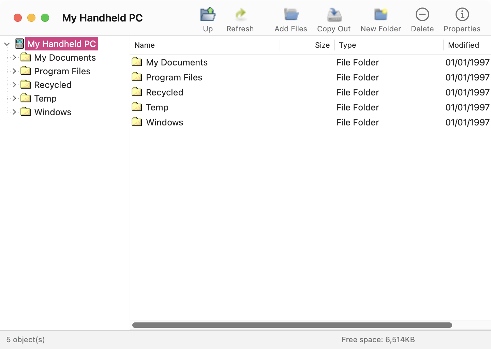
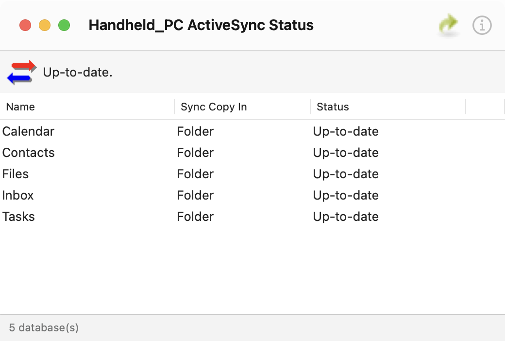
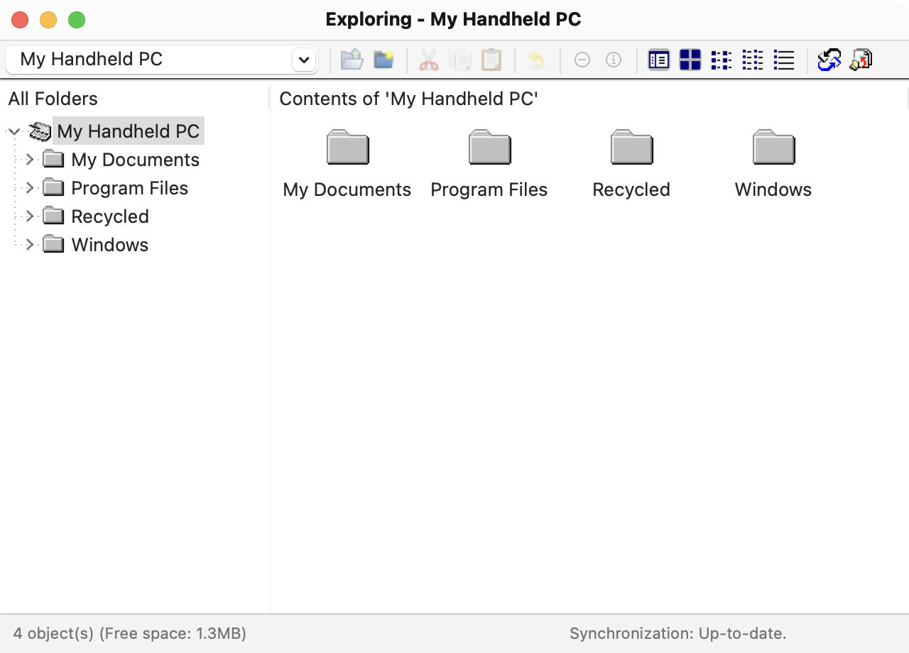
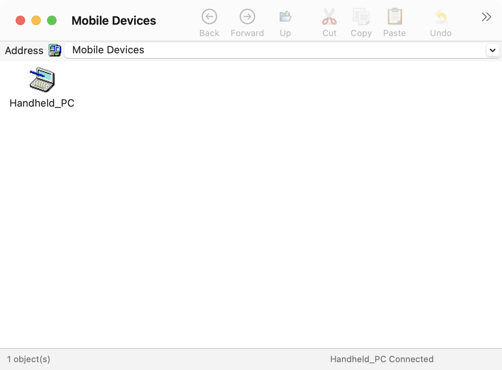

# ClassicSync

Connect Windows CE 1.x, 2.x and 3.x devices (Handheld PC, Palm-size PC, Pocket PC 2000/2002) to a modern Linux, macOS or Windows computer. ClassicSync recreates H/PC Explorer 1.1, Windows CE Services 2.2 and ActiveSync 3.1: browse and copy files, install programs, back up and restore, and synchronize contacts, calendar, tasks and documents.



ClassicSync is not affiliated with Microsoft. Windows CE, Handheld PC Explorer and ActiveSync are trademarks of Microsoft Corporation.

## Install

Download the archive for your computer from [Releases](https://github.com/grimace-sdk/classicsync/releases). Each contains the ClassicSync app and the `classicsync` command-line tool.

### Windows

1. Unzip `ClassicSync-<version>-windows-x86_64.zip` anywhere.
2. Run `ClassicSync\ClassicSync.exe`. The app is not signed, so Windows SmartScreen may ask you to confirm ("More info", then "Run anyway").

Serial cables appear as `COM1`, `COM3` and so on. USB-to-serial adapters need their maker's driver.

### macOS

1. Unzip `ClassicSync-<version>-macos-<arch>.zip` and move `ClassicSync.app` to Applications.
2. The app is not signed: the first time, right-click it and choose Open, then Open again.

Serial adapters appear as `/dev/cu.usbserial-...` or similar.

### Linux

1. Extract `ClassicSync-<version>-linux-x86_64.tar.gz`.
2. Run `ClassicSync/ClassicSync`. GTK 3 must be installed (it is on most desktops).
3. Give yourself access to serial ports: `sudo usermod -aG dialout $USER` on Debian and Ubuntu (`uucp` on Arch, `dialout` on Fedora), then log out and back in.

### With uv

If you have [uv](https://docs.astral.sh/uv/):

```
uv tool install "classicsync[gui,usb] @ git+https://github.com/grimace-sdk/classicsync"
classicsync-gui
```

On Linux, wxPython has no prebuilt wheel on PyPI; add `--find-links https://extras.wxpython.org/wxPython4/extras/linux/gtk3/ubuntu-24.04/` (choose your distribution) to avoid a long build.

## Connect your device

1. Plug the device into its cradle or serial cable, and the cable into your computer.
2. Start ClassicSync. The first time, it opens Connection Settings: pick your port, or click Get Connected to have ClassicSync find the device. Leave the speed on Automatic.
3. On the device, start the PC connection if it doesn't start by itself. Older devices dial at the speed set in their PC Link or Communications settings; 19200 is the safe default, 115200 is faster.

| Cable | Port to choose |
| --- | --- |
| Serial cable or serial cradle | the serial port (`COM1`, `/dev/ttyUSB0`, `/dev/cu.usbserial-...`) |
| USB cradle (iPAQ, Jornada, Cassiopeia E-series) | Nothing to choose: with "Allow USB connection" ticked (the default), ClassicSync connects as soon as a known cradle appears, alongside the serial port. On Linux the cradle may instead appear as `/dev/ttyUSB0`. macOS and Windows need libusb (`brew install libusb` on macOS; the WinUSB driver via Zadig on Windows). USB cradles have not been tested on hardware yet. |
| Infrared | an IR serial port, where your computer has one |
| An emulator offering its serial port over TCP | `tcp:HOST:PORT` |

When the device connects you can browse it (Explore), copy files in both directions, and add or remove programs. Pocket Word and Pocket Excel documents are converted to Word and Excel files as they are copied, and back again.



## Synchronize

Synchronization needs a partnership. When an unknown device connects, ClassicSync offers to set one up (a device can partner with two computers); otherwise it connects as a guest, which can browse, copy and install but not synchronize.

Synchronized information is kept in a folder you can open and edit:

| System | Folder |
| --- | --- |
| Linux | `~/.local/share/classicsync/<device name>/` |
| macOS | `~/Library/Application Support/classicsync/<device name>/` |
| Windows | `%LOCALAPPDATA%\classicsync\<device name>\` |

- `My Documents/`: the device's My Documents, file for file.
- `Converted/`: desktop copies of Pocket Word, Pocket Excel and 2bp files. Edit them and the next sync sends the changes to the device; new documents and spreadsheets there become device files.
  Copies are RTF and CSV on macOS (Excel workbooks if Numbers or Excel is installed), Word and Excel elsewhere. Choose RTF, Word, OpenDocument, HTML or text for documents and Excel, OpenDocument or CSV for spreadsheets in the folder provider's settings (`classicsync plugin configure folder converted_documents=odt`).
- `Contacts/*.vcf`, `Calendar/*.ics`, `Tasks/*.ics`: open them in any contacts or calendar app; edits go back to the device.

Choose what to synchronize, when, and how conflicts are settled in Options.



Instead of the folder, contacts, calendar and tasks can synchronize with a CalDAV/CardDAV server (iCloud, Fastmail, Nextcloud), Outlook on Windows, or Contacts, Calendar and Reminders on macOS. Notes can be kept as Markdown files, and a list of web pages can be copied to the device for offline reading. See [docs/sync-plugins.md](docs/sync-plugins.md#built-in-providers); other providers can be added as plug-ins.

## Choose the look

ClassicSync Settings (in the tray or menu bar icon's menu) chooses which original to recreate:

- Automatic: H/PC Explorer for Windows CE 1.x, Windows CE Services for 2.x, ActiveSync for 3.x, as you would have used at the time.
- H/PC Explorer 1.1, Windows CE Services 2.2 or ActiveSync 3.1, whatever the device.

| H/PC Explorer 1.1 | Windows CE Services 2.2 |
| --- | --- |
|  |  |

It also sets the language and the naming: ClassicSync, or the original product names for the full authentic experience.

### Translations

ClassicSync ships with the original artwork and English text. If you have localized ActiveSync installers, it can use their translations:

```
classicsync import-translations setup-async-4.5.msi async-4.5/ msasync.exe
```

Restart ClassicSync afterwards. Imported languages appear in ClassicSync Settings.

## More

- [CLI.md](CLI.md): the `classicsync` command-line tool.
- [DEVELOPERS.md](DEVELOPERS.md): building, testing and the code layout.
